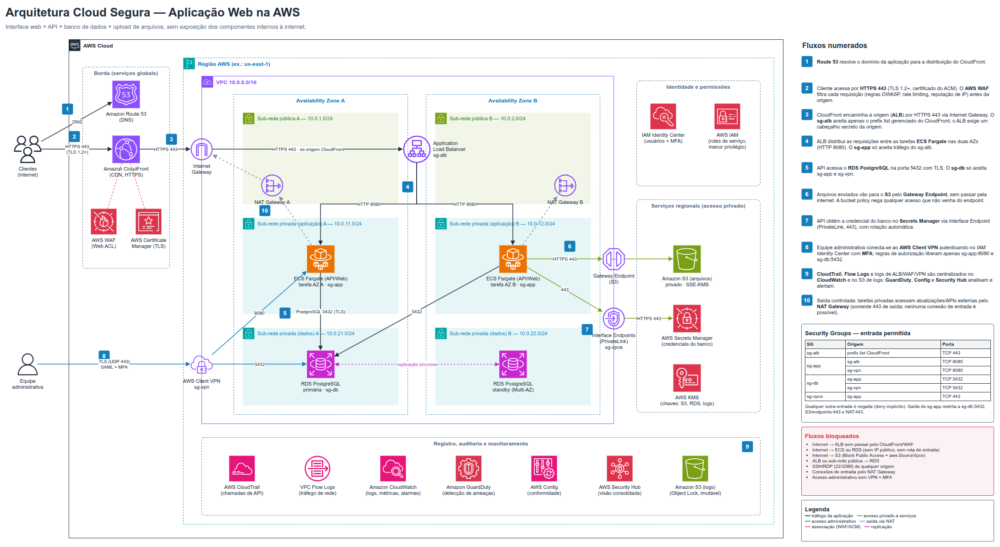

# Projeto: Arquitetura Cloud Segura (AWS)

Atividade **Projetar uma Arquitetura Cloud Segura**, do tema *Segurança Cloud: IAM, Redes e Boas Práticas*.

## Cenário

Uma empresa vai migrar para a AWS uma aplicação web composta por interface web, API, banco de dados e armazenamento de arquivos. O objetivo é que a aplicação funcione sem expor seus componentes internos à internet, com isolamento de recursos, controle de acesso, proteção das comunicações e monitoramento.

## Entregáveis

| Arquivo | Conteúdo |
|---|---|
| [`arquitetura-cloud-segura.drawio`](arquitetura-cloud-segura.drawio) | Diagrama editável (Draw.io / extensão do VS Code) |
| [`arquitetura-cloud-segura.png`](arquitetura-cloud-segura.png) | Exportação do diagrama em imagem |
| [`justificativa-tecnica.pdf`](justificativa-tecnica.pdf) | Justificativa técnica com as tabelas de fluxos de comunicação |
| [`justificativa-tecnica.md`](justificativa-tecnica.md) | Mesmo conteúdo do PDF, em Markdown |

## Resumo da arquitetura

- **Entrada única e protegida:** Route 53 → CloudFront (TLS do ACM) com AWS WAF → Application Load Balancer, que aceita tráfego apenas do CloudFront.
- **VPC em 3 camadas e 2 AZs:** sub-redes públicas (ALB, NAT), privadas de aplicação (ECS Fargate) e privadas de dados (RDS PostgreSQL Multi-AZ, sem rota para a internet).
- **Security Groups encadeados:** `sg-alb` (443 do CloudFront) → `sg-app` (8080) → `sg-db` (5432).
- **Arquivos:** S3 privado acessado pelo VPC Gateway Endpoint, com bucket policy restrita ao endpoint e criptografia SSE-KMS.
- **Acesso administrativo:** AWS Client VPN com autenticação federada (IAM Identity Center) e MFA, sem bastion e sem SSH.
- **Identidade e credenciais:** IAM Identity Center para pessoas, IAM roles de menor privilégio para serviços, Secrets Manager com rotação e KMS.
- **Auditoria:** CloudTrail, VPC Flow Logs, logs de ALB/WAF/VPN no CloudWatch, GuardDuty, AWS Config, Security Hub e bucket de logs com Object Lock.

Detalhes, tabelas de fluxos (origem, destino, protocolo, porta, finalidade) e conexões bloqueadas estão em [`justificativa-tecnica.pdf`](justificativa-tecnica.pdf).
